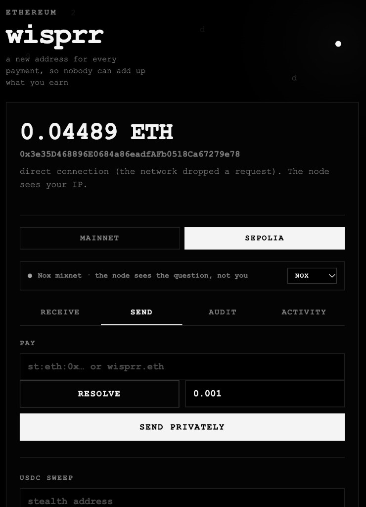

<p align="center">
  
</p>

<h1 align="center">wisprr</h1>

<p align="center">
  <em>Be paid by name. Arrive somewhere new every time.<br/>
  Nobody can add up what you earn.</em>
</p>

<p align="center">
  
</p>

<table align="center">
  <tr>
    <td align="center"><b>Anon-RPC</b><br/><sub>private transport</sub></td>
    <td align="center"><b>ENSv2</b><br/><sub>the name layer</sub></td>
    <td align="center"><b>ERC-5564</b><br/><sub>the payment layer</sub></td>
  </tr>
</table>

A privacy wallet for Ethereum. Chrome extension, self-custody, no backend.

Payments to you arrive at a different address every time, so nobody can add up what
you have received. Reads, broadcasts and name lookups leave through a mixnet, so the
node answering never learns your IP. Your payment identity is an ENSv2 name, so
someone can pay you by typing it instead of pasting a 141-character string.

Each piece is useful alone. Together they are the only combination where a person can
be paid repeatedly, by name, without anyone being able to total what they earn.

## Run it

```sh
npm install
npm run build
npm test
```
Download the extension zip isprr-extension.zip `https://github.com/Rxghavdev/wisprr/releases/tag/v0.1.0 w`

`chrome://extensions` → Developer mode → **Load unpacked** → select after extracting `wisprr-extension`.
Click the icon; the wallet opens in the side panel.

`npm test` runs **67 assertions** covering the stealth maths, interoperability against
ScopeLift's reference SDK, the leak guard, the disclosure windows, ENSv2 encoding and
address checksums. It runs without a browser. `TESTING.md` covers the parts that need
a real Chrome.

To try it you need Sepolia ETH from any faucet. The wallet ships on Sepolia for demo
purposes; switch the network toggle to Mainnet for real use.

---

## The problem, in one example

A freelancer publishes one address. Every client pays it. Anyone who looks it up
sees five clients, monthly, roughly what the freelancer earns. That is the default
for every wallet today, MetaMask included, and it is not fixable by being careful.

wisprr publishes a **meta-address** instead, which is not an address. It is two
public keys. Each payment to it gets its own throwaway address, derived from a
random key the sender picks and nobody publishes.

```
alice.eth  →  st:eth:0x0266f8…  →  payment #1  →  0x9df52441…
                                 →  payment #2  →  0x7057f3ba…
                                 →  payment #3  →  0xee4fe007…
```

Three payments, three unrelated addresses, one owner. Nobody can tell they belong
together, including the people who sent them.

---

## Who this is for

**Today: anyone paid in crypto who would rather not publish their income.** Freelancers
with a handful of clients. Contributors paid by several DAOs. People whose address
appears on a grant page, a donation link, or an NFT they minted years ago. Every one
of them currently publishes a running total of what they earn, because that is what a
static address is.

**Institutions need the same thing with a different word for it.** A fund receiving
subscriptions, a treasury paying contributors, a business settling with suppliers:
each is a counterparty-flow problem where the amounts must be visible to the auditor
and invisible to the market. That is not anonymity, it is **confidentiality with
scoped disclosure**, and it is what the third section below builds.

| Institutional requirement | How it maps here |
| --- | --- |
| Confidentiality from the market | Each payment lands at an unlinkable address |
| Confidentiality of positions | No aggregate balance is ever published |
| Auditability | Scoped grants: named grantee, purpose, date window |
| Least privilege | The audit key identifies payments and cannot move them |
| Revocability | Grants expire; the mandate is hashed and logged |
| No custodian | Self-custody throughout, no operator in the key path |

The honest gap: institutions also need counterparty screening and reporting rails,
and this build has neither. What it has is the disclosure primitive those rails would
sit on top of, which is the part most privacy systems get wrong by handing over an
irrevocable key.

---

## The reusable part

The wallet is the demonstration. The pieces underneath are meant to be taken
separately, and each is a self-contained module with tests.

| Module | What it does | Reusable by |
| --- | --- | --- |
| `src/lib/stealth.ts` | ERC-5564 derivation, verified against the reference SDK in both directions | any wallet, any dapp |
| `src/lib/rpc.ts` | Multi-network anonymised transport with honest fallback | anything that makes RPC calls |
| `src/lib/guard.ts` | Pre-signature leak checks as a rule set | any wallet that shows a spend button |
| `src/lib/grants.ts` | Scoped, expiring disclosure | any system that has to answer to an auditor |
| `src/lib/ens.ts` | ENSv2 hierarchy, resolution and record writes | any app that wants a name layer |
| `src/lib/token3009.ts` | Gasless token movement from a one-time key | any stealth implementation |

Two things here are not in any shipping product, and both are drop-in shaped:

**The leak guard.** Every wallet shows a spend button and warns after the fact. The
five rules in `guard.ts` are the published heuristics, expressed as a decision before
signing. A wallet does not need to be private to use it; it needs to care that it is
not actively undoing privacy.

**The scoped grant.** Viewing keys are account-wide, retroactive and irrevocable. A
grant is the opposite: bounded in time, bounded in purpose, hashed and logged, and
unable to spend. That envelope is what makes a privacy system usable by anyone who
reports to someone else.

Both are designed to be lifted as-is. Neither depends on this wallet, its UI, or the
mixnet.

---

## How the pieces fit

### 1. Anon-RPC: the transport for everything

`src/lib/rpc.ts`

Every RPC read, every transaction broadcast, every log query goes through a
hash-pinned anon-rpc worker running in a sandboxed iframe at a null origin. The
worker bundle is fetched at runtime and checked against its on-chain keccak256
before a byte of it executes, so the code that runs is pinned to mainnet rather
than to whoever controls a URL.

Three anonymising networks are supported, each behind its own specifier contract:

| Network | Transport | Boot time | Notes |
| --- | --- | --- | --- |
| **Nox** | Sphinx mixnet | fastest | Sepolia-native |
| **Tor** | full Tor client in WebAssembly | medium | needs a gateway |
| **Nym** | Nym mixnet | slowest | 18 MB bundle |

The wallet tries them in order of speed and falls back automatically. A dropdown
shows which one is live, and goes amber for a direct connection, because a privacy
wallet that quietly stops being private is worse than one that says so.

**Why this is load-bearing:** without it, checking a balance from your own IP puts
your address next to your IP in a provider's logs. Stealth addresses hide who owns
a payment. They do nothing about who is asking.

### 2. ERC-5564: stealth addresses

`src/lib/stealth.ts`, `src/lib/payments.ts`

The recipient's meta-address is two public keys. The sender generates an ephemeral
key, computes a shared secret with the recipient's viewing key, and derives a
one-time address that only the recipient can spend from.

Two keys, two jobs:

- **Viewing key** recognises which announcements are yours
- **Spending key** can move the funds

The viewing key alone cannot spend. That distinction is what §4 below is built on.

Scanning is done client-side against the canonical announcer at
`0x55649E01B5Df198D18D95b5cc5051630cfD45564`. A one-byte view tag rejects 255 of
256 announcements before any curve maths runs.

**Interoperability is tested, not assumed.** The test suite derives payments with
this implementation and recovers them with ScopeLift's reference SDK, then does the
reverse. Both directions pass. An earlier version hashed the shared secret
differently from the reference and produced addresses no other implementation could
open; the SDK cross-check is what caught it.

### 3. The leak guard: refusing to undo the privacy

`src/lib/guard.ts`

This is the part no other wallet has.

Sweeping a payment to your main wallet writes "this stealth address is mine" onto
the chain, permanently. Stealth addresses give you privacy when you receive, not
when you spend. Most wallets warn about this and let you proceed. This one refuses,
at the point of signing, in the background handler rather than only in the UI.

Five rules, taken from the published deanonymisation literature:

| Rule | Catches | Action |
| --- | --- | --- |
| H1 destination reuse | Sweeping to a wallet you are known at | **blocks** |
| H2 round trip | Sweeping back to whoever paid you | **blocks** |
| H3 collector pattern | Draining several stealth addresses together | warns |
| H4 gas funding | Sending ETH to a stealth address so it can pay | warns |
| H5 timing | Sweeping minutes after receipt | warns |

Each refusal explains what would have leaked, in plain language, and what to do
instead. The reason for blocking rather than warning: the published measurements
put linkable recipients at 44% to 73% across three generations of these systems,
and the leak is almost always at the spend step. They are the mistakes people
actually make.

### 4. Scoped disclosure grants: proving your history to one person

`src/lib/grants.ts`

An auditor needs to see flows. Everyone else does not. A raw stealth viewing key is
the wrong tool: it is account-wide, retroactive, irrevocable, and the holder decides
when to hand it over.

A grant is the opposite on every axis:

```
grantee:  Deloitte AG
purpose:  Q3 2026 flows
window:   2026-07-01 → 2026-10-01
expiry:   30 days
```

The grant carries the viewing scalar plus the spending **public** key. The auditor
can identify every payment inside the window. They cannot move a single one, and the
window is enforced before the cryptography runs, so payments outside it are never
recognised rather than filtered out afterwards.

`npm test` verifies that a payment inside the window is identified and the same
payment outside it is refused, at exact boundaries.

### 5. ERC-3009: moving tokens without funding the address

`src/lib/token3009.ts`

A stealth address holding USDC has no ETH and cannot pay for its own transfer.
Funding it from your wallet creates exactly the public link the guard exists to
prevent.

USDC implements EIP-3009, so the stealth key signs a `TransferWithAuthorization`
offline and this wallet submits it and pays the fee. The stealth address holds zero
ETH before, during and after.

The EIP-712 domain separator was verified byte-for-byte against the live contract,
and a signature was submitted to `transferWithAuthorization` on Sepolia: the
contract accepted it and failed only on zero balance, which is the correct failure
for an unfunded test account.

### 6. ENSv2: the name layer for private payments

`src/lib/ens.ts`

A 66-byte meta-address is unusable as an identifier. Nobody types
`st:eth:0x0266f8…` into a chat window. ENSv2 turns it into something a person can
share, and this wallet reads and writes the real v2 hierarchy rather than a v1
facade.

**What is actually used:**

| ENSv2 feature | Where |
| --- | --- |
| Hierarchical registries | `RootRegistry.getSubregistry("eth")` returns the ETH registry, and its `getParent()` returns `(RootRegistry, "eth")` |
| Universal Resolver v2 | `findResolver(name)` then `resolve(name, data)`, the two-step CCIP-Read-capable path |
| Per-account Permissioned Resolver | records written via `setText(bytes name, …)` to `0xa3c60944…`, the proxy deployed for this account |
| Registry-level metadata | `getStatus`, `getExpiry`, `getOwner` keyed by labelhash |

**The record:**

```
key:   stealth-meta-address[1]        (draft ENSIP, scheme 1 = secp256k1)
value: st:eth:0x0266f81a…4eab25a      (spending pub ‖ viewing pub)
```

Live on Sepolia: `wisprr.eth` publishes that record. ScopeLift's reference SDK reads
it and derives a payable stealth address from it.

**Why ENS is load-bearing here, not decorative:** without a name, the only way to
share a payment identity is to paste 141 characters and hope nothing truncates it.
With ENSv2, a payer types `wisprr.eth`, the wallet resolves it through the mixnet,
and the payment is unlinkable. Remove ENS and the wallet still works, but it stops
being something a person can hand to another person.

**The part nobody has shipped.** The same draft ENSIP defines a gateway path where
`addr()` returns a **fresh stealth address per lookup**, verified on chain with
`verifyStealthResolution`, so a gateway cannot redirect funds. That would let *any*
ENS-capable wallet pay a stealth name with no special support at all. The spec is
one draft file and no implementation exists. This wallet builds the record and the
reading side; the gateway is the next step.

**Privacy detail:** name resolution goes through the mixnet. A normal ENS lookup
tells your RPC provider which name you were interested in. Here it doesn't.

---

## How the two pillars reinforce each other

```
   ENSv2 name  ──resolved through the mixnet──►  meta-address
                                                        │
                                                        ▼
                                            ERC-5564 derivation
                                                        │
                                                        ▼
                                       one-time address, announced on chain
                                                        │
                                    scanning reads through the mixnet
                                                        ▼
                                             scannable only by you
```

Neither half is anonymous alone:

- **A name with no mixnet** leaks which name you looked up to your RPC provider. The
  record is public, but your *interest* in it is not something anyone should learn.
- **A meta-address with no name** is technically private and practically unusable.
  Nobody shares 141 characters by hand.

Anon-RPC makes ENS private. ENS makes stealth payments shareable. That is why both
are in the same wallet rather than two separate demos.


---

### A demo that works

1. **Receive** shows your meta-address. Use the copy button, not text selection.
2. **Scan payments** finds what you have received. First scan is slow; later ones
   are incremental.
3. **Send** accepts a meta-address **or an ENS name**. Type `wisprr.eth`, hit
   Resolve, and the meta-address fills in from the ENSv2 record, read through the
   mixnet. Paying derives a fresh address.
4. **Sweep** a payment to your own vault. It is refused, with an explanation. That
   refusal is the point.

The ENS step is worth showing on its own: the name resolves to a meta-address, not
to an address. That is what makes it payable repeatedly without a static address
appearing anywhere.

Live reference: `wisprr.eth` on Sepolia publishes a
`stealth-meta-address[1]` record, checkable at
[sepolia.app.ens.domains](https://sepolia.app.ens.domains).

---

## How this was built

Built at ETHGlobal Mumbai 2026 with Cursor as a pair-programming assistant.

**Human:** architecture, threat model, product decisions, which standards to use and
which to leave out, every on-chain verification, every test run, the demo design.

**AI:** code generation and refactoring across `src/lib/*.ts` and `src/ui/*.ts`,
README drafting, and contract research for ENSv2 and anon-rpc. Files most affected:
`stealth.ts`, `guard.ts`, `grants.ts`, `rpc.ts`, `token3009.ts`, `ens.ts`, `app.ts`.

Every cryptographic claim in this README was verified by running code against live
Sepolia or against ScopeLift's reference SDK, not by reading the specification. The
interoperability bug in `stealth.ts` was found by that cross-check: the shared secret
was hashed differently from the reference implementation, producing addresses no
other wallet could open. The test suite now asserts interop in both directions.

---

## CROPS

The Ethereum Foundation asks for one or two lines per letter.

**C: censorship resistance.** No server, no API, no relayer, no domain. Nothing to
switch off, nothing to refuse you. Recovery is twelve words. The only external
dependency is a public RPC, and you can point at a different one.

**O: open source.** MIT. `npm install && npm run build` builds the extension from
the repo with no private registry and no build server. The one runtime fetch is the
anon-rpc worker, verified against its on-chain hash before executing.

**P: what third parties learn.**

| Third party | Learns | Does not learn |
| --- | --- | --- |
| RPC provider, reads | The address or call you asked about | Your IP |
| RPC provider, broadcasts | The signed transaction | Your IP |
| Blockscout, data APIs | The address being looked up | Your IP |
| ERC-5564 announcer | A stealth address and an ephemeral key | Who owns it |
| ENS resolver | The name being resolved | Your IP |
| A site you connect | Your address | Any stealth payment |
| An auditor you grant | Payments inside the window | Anything outside it, and they cannot spend |

Two things do go out in the clear. The anon-rpc specifier read reveals that someone
at that IP runs an anon-rpc client, with no address attached. The bundle fetch
reveals an IP but not an address.

No analytics, no telemetry, no trackers.

**S: keys and trust.** The phrase is sealed with AES-GCM under PBKDF2 (120k
iterations, SHA-256) and lives unlocked only in `chrome.storage.session`, which is
memory-only. Every key is derived from the phrase on demand and never written down:
the vault account, the stealth spending and viewing scalars, and each per-payment
key.

You trust your own device, secp256k1, and nothing else in the privacy path. There is
no operator, notary, TEE or server. The announcer is a public contract that cannot
withhold announcements from you. The anon-rpc worker has no extension APIs and
cannot reach your keys.

---

## Where this stops

Written down because a privacy tool that hides its limits is lying.

1. **Almost nobody uses the standard.** The ERC-5564 announcer has had 222
   transactions in its entire mainnet history. The ERC-6538 registry has 10. About
   250 addresses have ever received a stealth payment on L1. That is the anonymity
   set, and it is small.

2. **Sweeping to your main wallet is a public link.** This build refuses to do it,
   but refusing is not fixing. A shielded pool or a relayer would; neither is here.

3. **Each payment is a separate address.** Receive fifty payments and you have fifty
   sweeps to do, or you spend directly from each address, which needs a relayer.
   That is the operational cost of unlinkability and it is why adoption is low.

4. **Timing correlates.** Receive at 14:02 and sweep at 14:03 and it is obviously one
   person. The published median gap is under a day.

5. **A viewing key is retroactive and irrevocable.** Grants add scope, expiry and a
   log, but anyone who has already seen data cannot be made to forget it.

6. **No screening.** Nothing proves non-membership in a sanctions list, and a
   counterparty cannot ask for that proof yet.

7. **Amounts are visible.** A stealth address hides who, not how much.

8. **The payer is visible.** When you pay someone privately your address is the
   `from`. This protects the recipient, not the sender.

9. **ERC-20 sweeps depend on the token.** ERC-3009 works because USDC implements it.

10. **Mainnet history needs an archive RPC.** Public nodes will not serve deep
    `eth_getLogs` without a token.

11. **Not audited.** Nobody has reviewed this code.

---

## Contracts

ERC-5564 and ERC-6538 sit at the same address on every chain, via CREATE2.

| What | Address |
| --- | --- |
| ERC-5564 announcer | `0x55649E01B5Df198D18D95b5cc5051630cfD45564` |
| ERC-6538 registry | `0x6538E6bf4B0eBd30A8Ea093027Ac2422ce5d6538` |
| Sepolia USDC (ERC-3009) | `0x1c7D4B196Cb0C7B01d743Fbc6116a902379C7238` |
| ENSv2 RootRegistry (Sepolia) | `0xB458D6a3a77919449d03e7A6903C26827c1eC43f` |
| ENSv2 ETHRegistry (Sepolia) | `0xD4eBcbBdF463C9c45784603Db0dDD499BC44A8B4` |
| ENSv2 UniversalResolver | `0xeEeEEEeE14D718C2B47D9923Deab1335E144EeEe` |
